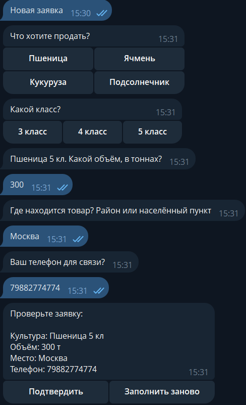
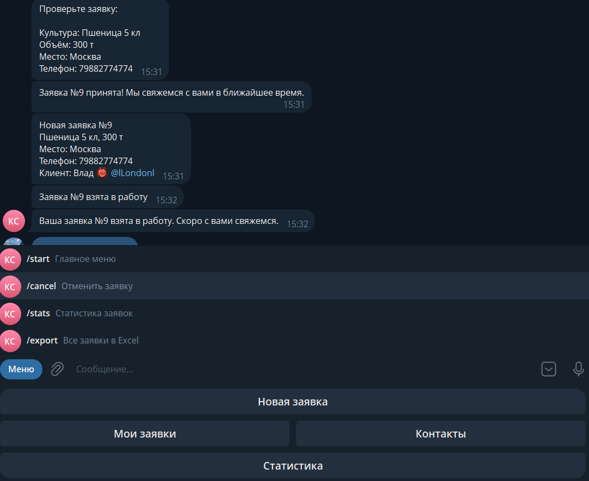

# Бот приёма заявок для закупщика зерна

Telegram-бот, который круглосуточно принимает заявки от фермеров на продажу урожая, сохраняет их в базу и сразу уведомляет менеджера.




## Что умеет

**Для клиента**
- Меню с кнопками: «Новая заявка», «Мои заявки», «Контакты»
- Пошаговая анкета: культура (для пшеницы — класс) → объём → место → телефон
- Проверка ввода: объём только числом, можно с запятой
- Сводка заявки с кнопками «Подтвердить» / «Заполнить заново»
- Номер заявки и уведомление, когда её взяли в работу
- Список своих заявок со статусами

**Для менеджера**
- Мгновенное уведомление о новой заявке с кнопкой «Взять в работу»
- Статусы заявок: «новая» → «в работе»
- `/stats` — статистика: сколько заявок и тонн по каждой культуре
- `/export` — все заявки одним файлом Excel
- Отдельное меню команд, которое клиенты не видят

## Стек

Python 3.12+, aiogram 3, SQLite, openpyxl, python-dotenv

## Структура

| Файл | Назначение |
|---|---|
| `bot.py` | запуск бота, меню команд |
| `handlers.py` | вся логика: команды, анкета, подтверждение, админка |
| `keyboards.py` | кнопки и меню |
| `states.py` | шаги анкеты |
| `db.py` | работа с базой SQLite и выгрузка в Excel |
| `config.py` | настройки из файла `.env` |

## Запуск

```bash
python -m venv .venv
.venv\Scripts\activate          # Windows
# source .venv/bin/activate     # Linux / macOS
pip install -r requirements.txt
python bot.py
```

## Настройки

Создайте рядом с `bot.py` файл `.env`:

```
BOT_TOKEN=токен_бота_от_BotFather
ADMIN_ID=telegram_id_менеджера
```

Файл `.env` не попадает в репозиторий — токен остаётся в секрете.
